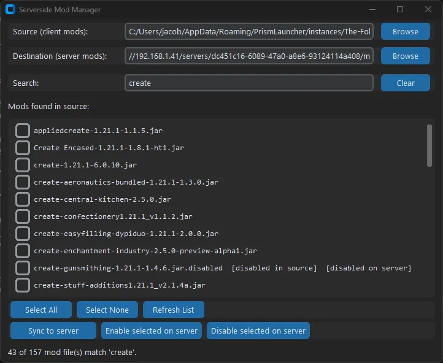

# Serverside Mod Manager

A small desktop tool for figuring out which mods from a client modpack
actually need to go on the server — and syncing them over — without the
manual, error-prone slog of doing it by hand every time a pack updates.

Built with Python + [CustomTkinter](https://github.com/TomSchimansky/CustomTkinter).



## Features

- **Folder pickers** for source (client `mods/`) and destination (server
  `mods/`), with paths persisted to `config.json` between runs.
- **Live search** — filter the mod list by filename as you type. Selections
  made before filtering are preserved even while a mod is hidden by the
  search.
- **Status tags per mod**, computed against both sides:
  - `[disabled in source]` — the client copy is already `.jar.disabled`.
  - `[disabled on server]` — present on the server but disabled there.
  - `[not synced]` — not present on the server at all yet.
- **Sync to server** — copies checked mods across, skipping any that
  already exist at the destination with a matching file size, so re-runs
  are fast.
- **Bulk or per-mod enable/disable** on the server side, done by renaming
  `X.jar` ↔ `X.jar.disabled`. This is a filesystem-level trick (loaders
  just glob for `*.jar`), so it works identically across Forge, NeoForge,
  Fabric, and Quilt.

## Requirements

- Python 3.10+
- `customtkinter`

## Install & run

```bash
pip install customtkinter
python main.py
```

## Usage

1. **Source** — point this at your client pack's `mods/` folder.
2. **Destination** — point this at the server's `mods/` folder. This can
   be a plain local path, a mapped network drive, or a raw network share
   path (UNC-style) such as:

   ```
   //192.168.1.41/servers/<server-id>/mods
   ```

   No drive mapping is required — Python resolves network share paths
   directly, so you can paste the share path straight in.
3. **Search** (optional) — type to filter the list down by filename.
4. **Check** the mods you want to act on.
5. **Sync to server** — copies checked mods across (skips anything already
   present with a matching size).
6. **Enable/Disable selected on server** — flips the checked mods between
   active and `.jar.disabled` on the destination side, without touching
   the client copy.

Paths are remembered automatically, so after the first run you just
reopen the app and go.

## Known limitations (by design, for v1)

- **No jar-parsing or auto-detection of "needed server-side."** This was
  considered and deliberately deprioritized:
  - Fabric/Quilt mods carry a genuine `environment` field in
    `fabric.mod.json` (`client` / `server` / `*`), which would make
    auto-detection reliable for those loaders.
  - Forge/NeoForge have no reliable equivalent — recent Forge versions
    dropped the formal sidedness attribute from `mods.toml`, and the
    optional `clientSideOnly` flag isn't consistently set by mod authors.
  - Since the primary target here is NeoForge, auto-detection wouldn't be
    trustworthy anyway, so this tool relies on manual toggling with full
    visibility (via the status tags) instead of guessing.
- No jar validation beyond file size comparison during sync (no hash
  check yet).

## License

Add a license of your choice here (MIT is a reasonable default for a
personal-use tool like this).
